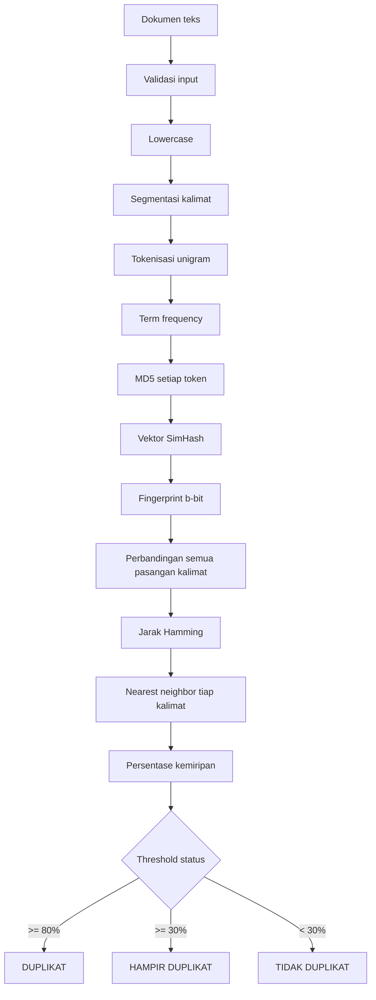

# Cara Kerja Deteksi Duplikat Dokumen Menggunakan SimHash dan Jarak Hamming

## 1. Ruang Lingkup

Dokumen ini menjelaskan alur pemrosesan teks pada projek `uas-fortext`, mulai dari teks mentah sampai keputusan status kemiripan dokumen.

Istilah "machine learning" dipakai dalam konteks analisis kemiripan teks berbasis fitur. Sistem ini **tidak** menjalankan pembelajaran model. Tidak ada training, dataset split, epoch, loss, model artifact, maupun parameter terpelajar. Seluruh proses bersifat deterministik dan berbasis aturan tetap.

Sumber utama:

- `fortext/preprocessing.py` — normalisasi, segmentasi kalimat, tokenisasi.
- `fortext/fingerprint.py` — hash token, vektor SimHash, fingerprint.
- `fortext/hamming.py` — jarak Hamming, rotasi, pencarian kandidat.
- `fortext/comparison.py` — perbandingan dokumen dan klasifikasi akhir.

## 2. Tujuan

Dokumen menjelaskan rantai proses berikut:

```text
Teks mentah
→ validasi
→ normalisasi
→ segmentasi kalimat
→ tokenisasi unigram
→ term frequency
→ hash MD5
→ vektor SimHash
→ fingerprint
→ jarak Hamming
→ persentase kemiripan
→ klasifikasi akhir
```

## 3. Karakteristik Pendekatan

- **Algoritma**: SimHash.
- **Tipe sistem**: deterministik dan rule-based.
- **Unit analisis**: kalimat.
- **Fitur**: token unigram.
- **Bobot fitur**: term frequency lokal per kalimat.
- **Fungsi hash**: MD5.
- **Ukuran fingerprint default**: `64` bit.
- **Ukuran kemiripan**: jarak Hamming.
- **Keluaran**: `DUPLIKAT`, `HAMPIR DUPLIKAT`, atau `TIDAK DUPLIKAT`.

MD5 dipakai untuk stabilitas hash antarproses, bukan untuk keamanan. Referensi: `fortext/fingerprint.py:11-18`.

## 4. Input dan Parameter

Input berupa minimal dua dokumen teks. Dokumen dapat berasal dari unggahan `.txt`, tempelan teks langsung, atau folder `contoh/`.

Parameter runtime:

| Parameter | Default | Fungsi |
| --- | ---: | --- |
| `b` | `64` | Panjang fingerprint dalam bit |
| `ambang` | `10` | Batas jarak untuk kalimat mirip |
| `ambang_min` | `3` | Batas kemiripan sangat kuat |
| `batas_duplikat` | `80` | Persentase minimum status duplikat |
| `batas_hampir` | `30` | Persentase minimum status hampir duplikat |

Referensi: `fortext/comparison.py:9-10` dan `app.py:62-64`.

## 5. Validasi Awal

Aturan validasi:

- Sistem memerlukan minimal dua dokumen.
- Setiap dokumen harus menghasilkan minimal satu kalimat bertoken.
- Dokumen kosong menghentikan perbandingan dan mengembalikan pesan kesalahan.
- Semua pasangan dokumen dibandingkan.

Jumlah pasangan untuk `n` dokumen:

```text
P = n(n-1)/2
```

Referensi: `fortext/comparison.py:67-89`.

## 6. Normalisasi

Fungsi `normalisasi()` mengubah seluruh teks menjadi huruf kecil.

```text
T_normal = lowercase(T)
```

Tujuan: menyamakan token seperti `Data`, `DATA`, dan `data`.

Sistem tidak menjalankan stemming, lemmatization, stopword removal, atau koreksi ejaan. Referensi: `fortext/preprocessing.py:8-10`.

## 7. Segmentasi Kalimat

Teks dipecah memakai:

- Tanda `.`, `!`, atau `?` yang diikuti whitespace.
- Satu atau beberapa baris baru.

Setiap kalimat memperoleh ID mulai dari `1`. Potongan kosong dibuang. Referensi: `fortext/preprocessing.py:13-20`.

## 8. Tokenisasi

Setiap kalimat dipecah menjadi token unigram memakai regex `\w+`.

Contoh:

```text
Input  : "Halo, dunia 2!"
Token  : ["halo", "dunia", "2"]
```

Tanda baca tidak menjadi fitur. Kalimat tanpa token dibuang dari proses berikutnya. Referensi: `fortext/preprocessing.py:23-25` dan `fortext/fingerprint.py:30-32`.

## 9. Term Frequency

Sistem menghitung frekuensi setiap token dalam satu kalimat.

```text
TF(t, s) = jumlah kemunculan token t dalam kalimat s
```

Frekuensi tersebut menjadi bobot token. Referensi: `fortext/fingerprint.py:34`.

## 10. Hash Token

Setiap token dikodekan sebagai UTF-8 lalu diproses dengan MD5. Nilai hash dipotong menjadi `b` bit:

```text
h_b(t) = MD5(t) mod 2^b
```

Pemotongan menjaga fingerprint sesuai panjang yang dipilih. Referensi: `fortext/fingerprint.py:11-18`.

## 11. Vektor SimHash

Sistem membuat vektor `V` berisi `b` komponen, semula bernilai `0`.

Untuk setiap token:

```text
V[i] = V[i] + TF(t, s)   jika bit hash ke-i bernilai 1
V[i] = V[i] - TF(t, s)   jika bit hash ke-i bernilai 0
```

Referensi: `fortext/fingerprint.py:35-44`.

## 12. Fingerprint Kalimat

Setiap komponen vektor diubah menjadi bit:

```text
FP[i] = 1   jika V[i] > 0
FP[i] = 0   jika V[i] <= 0
```

Bit kemudian digabung menjadi fingerprint integer sepanjang `b`.

Setiap hasil kalimat memuat:

- ID kalimat.
- Teks hasil normalisasi.
- Fingerprint integer.
- Fingerprint biner.

Referensi: `fortext/fingerprint.py:46-60`.

## 13. Jarak Hamming

Dua fingerprint dibandingkan menggunakan XOR lalu menghitung jumlah bit `1`.

```text
d_H(x, y) = popcount(x XOR y)
```

Nilai kecil menunjukkan fingerprint lebih mirip. Nilai `0` berarti kedua fingerprint identik. Referensi: `fortext/hamming.py:6-8`.

## 14. Perbandingan Semua Kalimat

Untuk dua dokumen A dan B, sistem membandingkan seluruh kombinasi kalimat `A × B`.

Jika A memiliki `m` kalimat dan B memiliki `n` kalimat, jumlah perbandingan adalah `m × n`.

Sistem menyimpan jarak minimum setiap kalimat terhadap semua kalimat dokumen lain. Referensi: `fortext/comparison.py:16-25`.

## 15. Penentuan Kalimat Mirip

Pasangan kalimat dianggap mirip jika:

```text
d_H < ambang
```

Operator yang digunakan adalah `<`, bukan `<=`. Semua pasangan mirip diurutkan berdasarkan jarak terkecil. Referensi: `fortext/comparison.py:27-29`.

## 16. Persentase Kemiripan

Setiap kalimat dihitung satu kali berdasarkan nearest neighbor terbaiknya.

```text
Similarity = ((matched_A + matched_B) / (|A| + |B|)) × 100%
```

Pendekatan simetris mencegah hasil hanya bergantung pada satu dokumen. Referensi: `fortext/comparison.py:30-32`.

## 17. Keputusan Akhir

Aturan klasifikasi:

| Persentase | Status |
| ---: | --- |
| `>= 80%` | `DUPLIKAT` |
| `>= 30%` dan `< 80%` | `HAMPIR DUPLIKAT` |
| `< 30%` | `TIDAK DUPLIKAT` |

Threshold bersifat hard-coded dan belum dikalibrasi memakai dataset berlabel. Referensi: `fortext/comparison.py:34-39`.

## 18. Kemiripan Sangat Minimal

Sistem menghitung metrik tambahan memakai:

```text
d_H <= ambang_min
```

Persentasenya dihitung dengan rumus simetris yang sama. Metrik ini hanya memberi informasi tambahan dan tidak menentukan status akhir. Referensi: `fortext/comparison.py:41-44`.

## 19. Rotasi dan Pengurutan Kandidat

Fingerprint dirotasi ke kanan sebanyak `0`, `2`, dan `4` bit. Bit yang keluar dari kanan masuk kembali dari kiri.

Setelah rotasi:

1. Fingerprint dokumen A dan B digabung.
2. Item diurutkan berdasarkan nilai desimal.
3. Item bertetangga dari dokumen berbeda dibandingkan.
4. Kandidat disimpan jika `jarak <= ambang`.

Referensi: `fortext/hamming.py:11-18` dan `fortext/hamming.py:25-48`.

Tahap ini hanya menghasilkan kandidat diagnostik. Status akhir tetap memakai perbandingan penuh `A × B`.

## 20. Perbandingan Banyak Dokumen

Sistem membentuk semua pasangan unik:

```text
A-B
A-C
A-D
B-C
B-D
C-D
```

Setiap pasangan menjalankan pipeline yang sama secara independen. Referensi: `fortext/comparison.py:81-89`.

## 21. Struktur Output

Setiap hasil pasangan memuat:

- Nama dokumen A dan B.
- Status.
- Persentase kalimat mirip.
- Persentase kemiripan sangat minimal.
- Jumlah kalimat.
- Daftar pasangan kalimat mirip.
- Kandidat hasil rotasi.
- Fingerprint desimal.
- Fingerprint biner.
- Parameter runtime.

Referensi: `fortext/comparison.py:49-64`.

## 22. Kompleksitas

Praproses bergantung pada jumlah karakter dan token.

Pembentukan fingerprint membutuhkan sekitar `O(T × b)` dengan `T` sebagai jumlah token.

Perbandingan utama membutuhkan `O(m × n)` per pasangan dokumen.

Untuk banyak dokumen, biaya meningkat pada seluruh pasangan dokumen. Rotasi dan pengurutan kandidat tidak mengurangi biaya keputusan akhir.

## 23. Pengujian

Cakupan tes saat ini:

- Segmentasi kalimat.
- Tokenisasi.
- Jarak Hamming.
- Rotasi fingerprint.
- Stabilitas fingerprint.
- Dokumen identik.
- Hampir duplikat.
- Tidak duplikat.
- Semua pasangan dokumen.
- Dokumen kosong.
- Integrasi antarmuka.

Referensi: `tests/test_fortext.py:20-59` dan `tests/test_ui.py:23-55`.

Tes menguji perilaku yang diharapkan, bukan akurasi statistik.

## 24. Batasan

- Tidak ada training atau model terpelajar.
- Tidak ada dataset train, validation, dan test.
- Tidak ada precision, recall, F1-score, atau confusion matrix.
- Threshold `80%` dan `30%` belum dikalibrasi.
- SimHash tidak memahami konteks semantik.
- Urutan kata kurang terwakili karena fitur unigram.
- Segmentasi sederhana dapat salah menangani singkatan.
- Stopword tetap memengaruhi fingerprint.
- Perbandingan penuh mahal untuk dokumen besar.
- Rotasi kandidat belum dipakai untuk mempercepat keputusan.
- Antarmuka mengizinkan `ambang > b` saat `b < 64`.
- Hasil tidak disimpan permanen.

## 25. Diagram Alur


